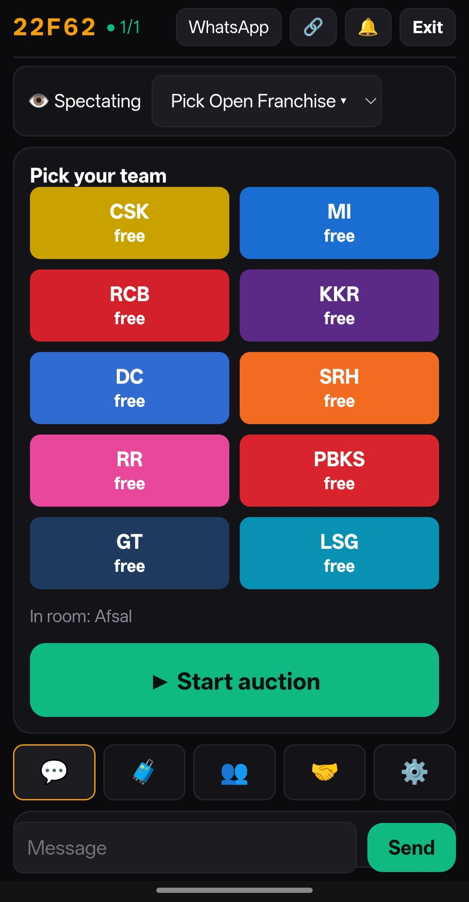
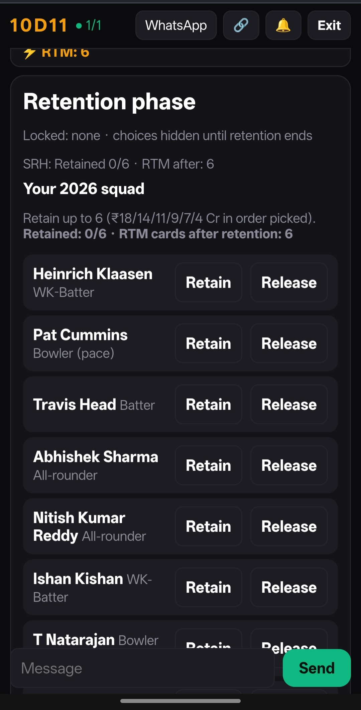
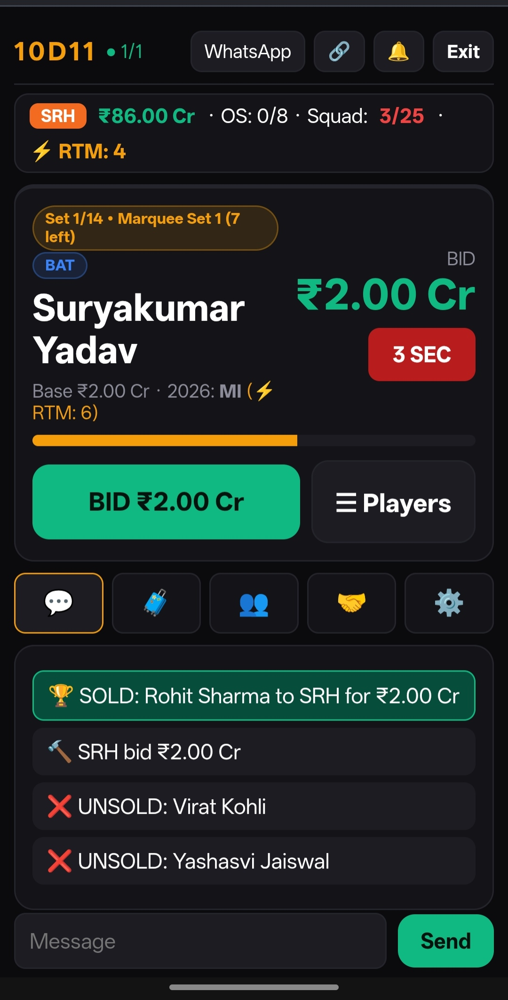

# IPL Auction 2027 — Real-Time Multiplayer Mega Auction Simulator

[](https://afsalcricket-a11y.github.io/IPL-auction-27/)
[](https://supabase.com/)
[](https://www.postgresql.org/)

---

## 1. Overview & Live Demo Link

**Live Application:** [https://afsalcricket-a11y.github.io/IPL-auction-27/](https://afsalcricket-a11y.github.io/IPL-auction-27/)

**IPL Auction 2027** is a mobile-first, real-time multiplayer cricket auction web application built to replicate the complete Indian Premier League Mega Auction experience. Friends and league organizers can spin up instant auction rooms, share invite links via WhatsApp, claim any of the 10 IPL franchises (`CSK`, `MI`, `RCB`, `KKR`, `DC`, `SRH`, `RR`, `PBKS`, `GT`, `LSG`), execute blind pre-auction retentions with dynamic Right-to-Match (RTM) allocations, bid across **14 structured auction sets (250 players)**, and negotiate multi-player and cash trades in real time.

### Core Capabilities
* **Franchise Selection & Room Lobby:** Instant room creation with unique room codes (e.g., `22F62`, `10D11`), live participant presence, spectator mode (`Pick Open Franchise`), and one-tap WhatsApp invite sharing.
* **Blind Pre-Auction Retention Phase:** Retain up to 6 players from your 2026 squad using official tiered deductions (`₹18 / ₹14 / ₹11 / ₹9 / ₹7 / ₹4 Cr`), with selections hidden until all franchises lock in and unused retention slots automatically converted into RTM cards.
* **Live Auction Bidding Room:** Synchronized countdown timers (`5s` / `10s`), live purse (`₹ Cr`), overseas player slot tracking (`OS: 0/8`), squad cap enforcement (`25` max), and an integrated live hammer/chat stream (`SOLD`, `UNSOLD`, `RTM`).
* **Set-Wise Player Pool & Auction Stats:** Real-time breakdown of all **250 players** across **14 sets** (Marquee, Capped Batters, Wicketkeepers, All-Rounders, Fast & Spin Bowlers) filterable by `Up`, `Sold`, `Unsold`, and playing role.
* **Multi-Player & Cash Trade Engine:** Mid-auction bilateral trading between franchises supporting multi-player swaps alongside purse cash compensation (`+ Cash you send` / `+ Cash you ask`) with room-wide celebration banners.
* **Host Controls & Room Settings:** Configurable bid timers, per-player Max Bid Caps (`Unlimited`, `₹15 Cr`, `₹20 Cr`, `₹25 Cr`, `₹30 Cr`, or custom `Cr`), late-joining and spectator permissions, live retention visibility toggles, and real-time `Pause` / `Skip` / `End` controls.

---

## 2. Screenshots

### Lobby, Retention & Live Bidding Room

| Franchise Lobby & Team Selection | Blind Pre-Auction Retention Phase | Live Auction Bidding Room |
| :---: | :---: | :---: |
|  |  |  |
| *Claim any of the 10 IPL franchises or join as a spectator* | *Tiered retention slabs (`₹18–4 Cr`) & automatic RTM calculation* | *Synchronized countdown, live purse/OS tracker & hammer feed* |

### Pool Analytics, Trading, Host Controls & Live Rosters

| Set-Wise Player Pool & Stats | Multi-Player & Cash Trade System | Host Controls & Room Settings | Live Franchise Rosters |
| :---: | :---: | :---: | :---: |
|  |  |  |  |
| *250 players across 14 sets filterable by `Up`, `Sold`, `Unsold` & role* | *Swap multiple players & cash between teams with live announcements* | *Configure bid timers, Max Bid Cap per player & `Pause`/`Skip`/`End`* | *Track claimed franchises, host badge & live squad counts* |

---

## 3. System Architecture & Security

IPL Auction 2027 runs on a **serverless real-time event architecture** hosted on GitHub Pages and backed by **Supabase (PostgreSQL + Realtime WebSockets + PostgREST RPCs)**. All state transitions—bids, countdown expirations, RTM challenges, retention locks, and player trades—are validated and executed atomically inside PostgreSQL so every connected browser stays synchronized.

```text
+-----------------------------------+     WebSockets / RPC     +----------------------------------------+
|    Multiplayer Client (Browser)   | <----------------------> |       Supabase Realtime & API          |
|  - Live Bidding & Countdown UI    |                          +----------------------------------------+
|  - Retention & RTM Modal Flows    |                                              |
|  - Multi-Player Trade & Host UI   |                                              v
+-----------------------------------+                          +----------------------------------------+
                                                               |     PostgreSQL State & Security        |
                                                               |  - Normalized Auction & Room Tables    |
                                                               |  - Row-Level Security (RLS) Policies   |
                                                               |  - Atomic PL/pgSQL RPC Transactions    |
                                                               +----------------------------------------+
```

### Database Schema (Supabase Tables)
* **`rooms`:** Stores room state and host configuration (`room_code`, `host_name`, `auction_mode`, `bid_timer_sec`, `max_bid_cap`, `status`, `current_player_id`, `current_bid`, `highest_bidder_team`, `timer_expires_at`, `allow_late_join`, `allow_spectators`).
* **`members` & `room_teams`:** Maps connected participants to their claimed franchise (`CSK`–`LSG`), tracks online presence, remaining purse (`₹ Cr`), overseas player count (`max 8`), squad size (`max 25`), and available `rtm_cards`.
* **`players` & `room_players`:** Master catalog of **250 players** structured across **14 auction sets** (Marquee, Capped Batters, All-Rounders, Wicketkeepers, Fast & Spin Bowlers) paired with per-room status (`upcoming`, `active`, `sold`, `unsold`), `sold_price`, and `owner_team`.
* **`retention` & `ret_lock`:** Records blind pre-auction retentions (`₹18 / ₹14 / ₹11 / ₹9 / ₹7 / ₹4 Cr` slabs) per franchise and tracks lock-in readiness before revealing squads and issuing remaining RTM cards.
* **`trades`:** Stores multi-player and cash trade offers (`from_team`, `to_team`, `offered_player_ids`, `requested_player_ids`, `cash_delta`, `status`) and broadcasts accepted trades to the entire room.
* **`chat`:** Real-time room message stream merging participant chat with automated auctioneer events (`SOLD`, `UNSOLD`, `RTM`, `TRADE`).

### Row-Level Security (RLS) & Atomic RPC Functions
* **Room-Scoped Isolation:** RLS policies restrict reads and writes to the active `room_id`, enforcing spectator and late-join permissions at the database layer.
* **Blind Retention Confidentiality:** During the `retention` phase, RLS policies prevent rival franchises from querying uncommitted rows in `retention` until every active team completes `ret_lock`.
* **Transactional Bidding & Settlement (`place_bid`, `resolve_player`, `accept_trade`):** Rather than permitting direct client updates to `rooms` or `room_teams`, `SECURITY DEFINER` PostgreSQL RPC functions validate remaining purse, host `Max Bid Cap`, overseas squad limits (`<= 8`), and server clock expiration inside a single transaction.

---

## 4. Key Engineering Challenges Solved

### 1. Synchronizing Live Countdown Timers & Concurrent Bids Across Rooms
* **Problem:** Independent client-side timers drift across mobile and desktop browsers, creating race conditions where two franchises appear to win the same player simultaneously.
* **Solution:** Anchored the auction clock to a server-authoritative `timer_expires_at` timestamp in PostgreSQL. Each `place_bid` RPC atomically applies official IPL bid increments, updates `highest_bidder_team`, and resets `timer_expires_at` (`+5s` / `+10s`), broadcasting the canonical state via Supabase Realtime.

### 2. Enforcing Tiered Retention Slabs, 15-Second RTM Windows & Host Bid Caps
* **Problem:** Computing dynamic RTM cards (`6 - retained_count`), deducting tiered retention slabs (`₹18/14/11/9/7/4 Cr`), enforcing 15-second RTM counter-bid challenges, and honoring host-configured `Max Bid Cap` limits require strict server-side invariants.
* **Solution:** Encapsulated retention lock-in, RTM eligibility checks, and per-player bid-cap validation directly inside PostgreSQL RPC transactions so invalid or over-budget actions are blocked before state mutation.

### 3. Atomic Multi-Player & Cash Trade Execution
* **Problem:** Bilateral trades combining multiple players and purse adjustments (`+ Cash you send` / `+ Cash you ask`) must transfer all player ownership records and update both franchises' purses together without partial writes.
* **Solution:** Built an atomic `accept_trade` RPC that verifies current ownership of all involved players, validates post-trade purse and overseas quotas (`<= 8 OS`), swaps `owner_team` assignments in `room_players`, adjusts `room_teams` purses, and publishes a room-wide trade confirmation event in one transaction.
